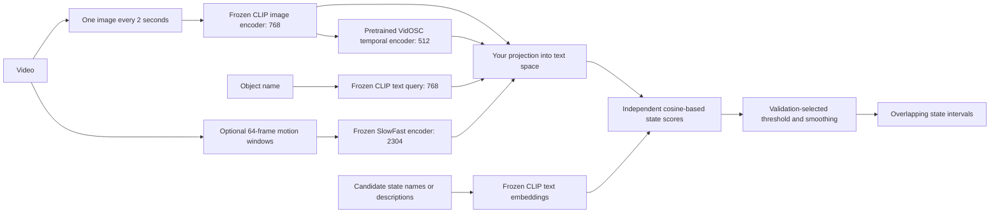

# Your multi-state extension

VidOSC and CLIP are existing pretrained models. Your contribution here is the object-conditioned text scorer, its fine-tuning procedure, the optional SlowFast feature fusion, variable candidate interface, and the evaluation protocol. All adaptations are in your own module.

An example candidate list might have four states: whole, peeled, chopped, mayonnaise-mixed. Another might have 12. The same projection weights score either list; there is no four-class output layer. A time can activate peeled and chopped together. Removing a candidate does not change the remaining candidates' raw scores.

The model does not automatically infer a new vocabulary or name unknown states. This experiment uses the 77 named CMU candidates at evaluation. The number of active states can vary; the candidate inventory remains supplied by you.

The temporal transformer uses the full sampled video in both directions. Motion windows look ahead about two seconds from each anchor. This is offline video analysis, not a causal live streaming implementation.

An object-name query helps distinguish targets such as eggs and egg mixture within one recording. It is not an object crop or tracker. The full-frame representation can still confuse objects or learn recipe context.

The original VidOSC encoder expects two 768-dimensional streams: global features and object features. Here, CLIP supplies the global stream and the object stream is zero-filled. That changes its input distribution. Fine-tuning adapts your copy of the encoder; it does not edit the original code or checkpoint.

The head first learns from automatic training annotations with the encoder frozen. A second stage considers fine-tuning the temporal encoder. Human-labelled validation videos choose the retained stage, epoch, threshold, and smoothing. Human-labelled test videos measure the final result once those choices are locked.
