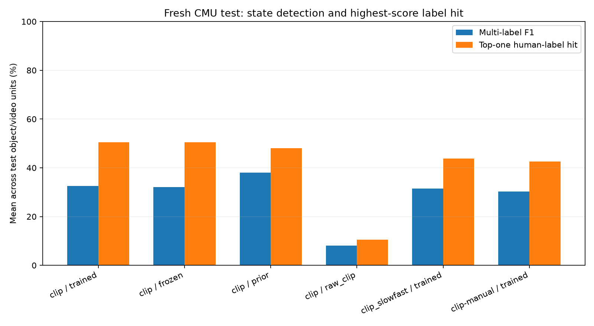
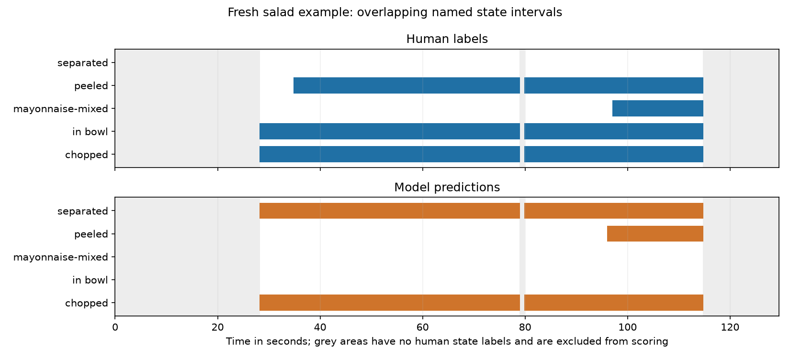

# Broader multi-state VidOSC results

The model selected using validation alone was **clip-manual**. On the seven fresh object/video test units, it achieved **30.3% mean multi-label F1** and **42.6% mean top-one label-hit accuracy**. It beats the matched constant-prior baseline's 28.4% mean F1.

**The accuracy goal is not achieved.** All learned variants score below the stronger pseudo-training constant prior's **38.1% F1**. The selected model reaches only 2.7% F1 on the unseen pizza targets, and held-out peeled detection scores zero F1. The implementation supports variable candidates, but reliable unseen-object or unseen-state recognition has not been demonstrated.

The primary custom CMU pilot uses 21 videos: 12 pseudo-labelled training videos, four human-labelled validation videos, and five fresh human-labelled test videos. A separate manual-supervised comparison adds four human-labelled training recordings, for 25 unique videos overall. Subjects are separate within each comparison. The seven test units include two targets in eggs and two in pizza. All videos are still in the CMU kitchen; this is not evidence about other kitchens or arbitrary foods.

An exploratory paired bootstrap over whole test recordings gives a 95% interval for the F1 difference versus prior of **-8.5 to +9.7 percentage points**. There are only five recordings, so treat this as an indication of uncertainty rather than a broad reliability guarantee.

## What the percentages mean

Top-one label-hit accuracy asks whether the single highest-score state belongs to the human label set at an annotated time. It can look good even while the model predicts too many extra states. Multi-label F1 measures the balance between finding correct states and avoiding extra states, including simultaneous states. The table's percentages are means across object/video units, not one pooled percentage over all frames. A two-second sample is repeated across raw frames; those frames are not independent trials.

These scores measure agreement with the dataset's named labels. Each target is an ingredient/object category such as vegetables or eggs, potentially combining several physical instances. This evaluation does not measure per-instance tracking, object presence, or segmentation accuracy.

Segment F1 at IoU 0.5 tests whether a predicted named interval overlaps a human interval enough, with one-to-one matching. State-count error is the average absolute difference between the number of distinct predicted and human-labelled states on annotated frames. Exact label-set accuracy and per-state precision/recall/F1 are in the evaluation JSON files.

## Comparisons

| Model / method | Mean F1 | Mean top-one hit | Mean state F1 | Segment F1 @ .5 | Count error |
|---|---:|---:|---:|---:|---:|
| clip / trained | 32.5% | 50.5% | 33.6% | 24.1% | 8.86 |
| clip / frozen | 32.1% | 50.5% | 33.3% | 24.2% | 8.86 |
| clip / prior | 38.1% | 48.0% | 25.1% | 35.7% | 2.43 |
| clip / raw_clip | 8.1% | 10.5% | 25.4% | 1.9% | 38.14 |
| clip_slowfast / trained | 31.6% | 43.8% | 32.8% | 17.7% | 15.43 |
| clip_slowfast / frozen | 31.6% | 43.8% | 32.8% | 17.7% | 15.43 |
| clip_slowfast / prior | 38.1% | 48.0% | 25.1% | 35.7% | 2.43 |
| clip_slowfast / raw_clip | 8.1% | 10.5% | 25.4% | 1.9% | 38.14 |
| clip-manual / trained | 30.3% | 42.6% | 34.2% | 25.9% | 14.00 |
| clip-manual / frozen | 30.4% | 45.5% | 34.5% | 22.4% | 15.29 |
| clip-manual / prior | 28.4% | 13.5% | 24.6% | 28.0% | 3.71 |
| clip-manual / raw_clip | 8.1% | 10.5% | 25.4% | 1.9% | 38.14 |

All epochs, thresholds, smoothing, and the regular-model winner were chosen using validation, then locked before test evaluation. 'Frozen' fits the own text head while retaining the original VidOSC encoder; 'trained' additionally considers fine-tuning, retained only if validation improves. Prior uses per-object training label frequencies, with a global fallback for new objects. Raw CLIP compares image and text embeddings without fitting VidOSC. Each method gets its own validation-selected threshold and smoothing.

The **clip-manual** method uses the same architecture and training budgets on four human-labelled training recordings, one per recipe, with four target units. It was added after the pseudo-supervised model nearly tied the prior on validation and the training audit showed persistent automatic labels. This decision was declared before fresh test prediction or scoring. Both recordings and supervision source differ, so this comparison does not isolate a causal label-quality effect. Its eggs training recording has no separate egg-mixture annotation; that query receives no direct training examples.

Training-recipe transfer: mean F1 41.3%. Test-only pizza recipe and cheese/batter objects: mean F1 2.7%. The pizza slice is just one recording with two targets; do not generalize this number to every unseen recipe.

## Fresh test units

| Video / target | F1 | Top-one hit | Human distinct states | Predicted distinct states | Missed human states |
|---|---:|---:|---:|---:|---|
| S15_Salad_7150991-451::vegetables | 45.6% | 21.9% | 4 | 3 | in bowl, mayonnaise-mixed |
| S16_Eggs_7150991-858::eggs | 20.2% | 14.2% | 3 | 12 | none |
| S16_Eggs_7150991-858::egg mixture | 40.1% | 100.0% | 7 | 12 | flipped, in-pan, served, solid |
| S19_Brownie_7150991-848::eggs | 45.0% | 79.1% | 4 | 6 | none |
| S36_Sandwich_7150991-165::bread slices | 55.5% | 83.2% | 7 | 2 | chopped, jam-topped, peanut-butter-and-jam-covered, placed, pressed-together |
| S20_Pizza_7150991-180::cheese | 1.3% | 0.0% | 3 | 19 | grated, scattered |
| S20_Pizza_7150991-180::batter | 4.2% | 0.0% | 5 | 65 | cheese-covered, in-oven, topped with pepperoni |

## Held-out state-name experiment

The separate CLIP run withheld **peeled** from supervised train/validation candidates and excluded labelled frames containing it. Evaluation restored all 77 names. Peeled occurs in 1 test unit(s); its mean F1 over those units is 0.0%.

This tests transfer to a held-out labelled state name. Pretrained CLIP/VidOSC and unsupervised temporal context may have seen the appearance, so it is not a claim that the model has never seen peeled vegetables. Custom free-form descriptions are supported inputs but require their own annotated evaluation.

## What was changed

Your own object-conditioned text scorer takes CLIP visual features, VidOSC temporal context, and an object-name embedding. The motion version adds official SlowFast R50 Kinetics400 features. An own MLP maps these to centered CLIP text embeddings. Independent sigmoid scores allow overlapping states and a variable number of active states. The original four-class output is bypassed. These scores are not calibrated probabilities.

The candidates for this evaluation are still the 77 CMU state names. The model selects from them; it does not invent state names or discover an unrestricted state vocabulary. There are no object crops or tracker; full-frame features and an object-name query approximate object conditioning, and VidOSC's object-feature input is zero-filled. The transformer sees the full video and motion windows look ahead, so this is offline analysis rather than causal live streaming.

## Verification and limits

The fourteen broader tests check frame-clock conversion, dense versus binned metric agreement, interval matching, unknown annotation gaps and annotation tails, held-out label exclusion, subject leakage checks, candidate subset/order consistency, object-query effects, cached context equivalence, shared-query gradient equivalence, and encoder gradients. Nine legacy tests also pass. GPU outputs were checked against CPU implementations on synthetic inputs and real training frames. SlowFast uses verified half precision; CLIP uses full precision after its half-precision check failed.

Training pseudo labels can persist when the target is outside the view. The training-only audit sheet records examples; no labels were manually corrected. The primary pseudo-supervised runs reserve manual labels for validation/test; clip-manual uses a separate, subject-disjoint human training set. This training-label noise and missing object localization remain material limitations.

The genuine InternVideo comparison remains pending because its official pretrained checkpoint is gated and unavailable in this environment. The adapter is implemented, but no InternVideo scores are claimed. The source-code GitHub link alone does not provide those weights.

No teammate source files were edited. No commits, pushes, or pull requests were made. Checkpoints, manifests, predictions, per-unit/per-state metrics, and intervals are saved in this own module. The previous 60.7% salad pilot used different training labels, a narrower split, and different preprocessing, so it is not a like-for-like comparison with this broader test.

Test results are now exposed. Changes motivated by these scores need a new held-out split to support a fresh generalization claim.

A concrete example of a misleading headline: the fresh egg-mixture target has 100% highest-label hit accuracy, but just 40.1% multi-label F1 and 0% exact label-set accuracy. It has seven human-labelled distinct states, while the selected model predicts 12, missing flipped, in-pan, served, and solid. Correctly ranking one common label does not mean the complete state description is correct.

The next experiments should address object localization, normalization and candidate centering for unseen object names, and how never-positive state candidates are treated during training. The current model can produce many extra states for new queries (65 predicted names for pizza batter versus five human-labelled names). Post-evaluation diagnostics are saved separately; they suggest possible contributors without establishing causation. Use fresh recordings for the next generalization test.

