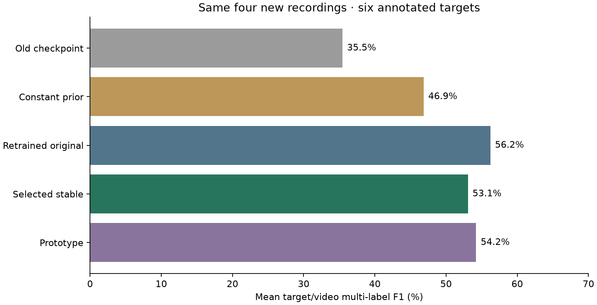

# Fresh accuracy experiment

Validation selected **stable** before fresh test scoring. Its mean target/video
multi-label F1 is **53.1%**, compared with
**46.9%** for the same-training-data prior and
**35.5%** for the unchanged original checkpoint
on these same new recordings. Original results and checkpoints are preserved.

| Method | Fresh F1 | Highest-label hit | Exact label set |
|---|---:|---:|---:|
| prior | 46.9% | 57.0% | 1.5% |
| original | 56.2% | 72.6% | 1.5% |
| original_blend | 56.2% | 72.6% | 1.5% |
| stable | 53.1% | 72.9% | 1.5% |
| stable_blend | 53.1% | 72.9% | 1.5% |
| prototype | 54.2% | 59.0% | 2.5% |
| legacy | 35.5% | 42.9% | 0.0% |

Nine human-labelled training recordings and five validation recordings were
used. Old exposed tests are development data now. The fresh test has four new
subjects/recordings, six targets, in the same CMU kitchen. This evaluates known
target categories, including pizza examples now present in training; it does
not establish arbitrary-object or unseen-state recognition. Split planning
used video/object names and source annotations for splitting, not fresh scores.

The original-head and stable models use the same new data/loss/budget. Stable
uses fixed query scaling and query-relative text centering. Prototypes learn
positive/negative visual-temporal directions for supported object/state names;
this calibration does not establish recognition of unseen descriptions.
All models use frozen CLIP/VidOSC features. There are no object crops/tracker.

Every method's prediction was saved and hashed before fresh annotation export
and scoring. Selection locks and per-unit/interval metrics are in results/.
Scores are means over target/video units; frames repeated from two-second
samples are correlated. The earlier 30.3% result was on a different test set.
Use the unchanged legacy model scored here for a direct comparison.

Michelle and Shray pursue similar semantic-state goals. Her pipeline obtains
descriptions with Claude after VidOSC phases; this experiment trains/calibrates
temporal state scores. Architectural difference alone is not proof of novelty
or better recognition.

See [CHANGES.md](CHANGES.md) for the implementation walkthrough and interpretation.

## Audit and limitations

Stable was selected on validation and remains the selected model. The retrained original architecture scored 56.2% F1 on the fresh test, versus stable’s 53.1%. The query-scaling/centering changes therefore did not improve test F1 in this run. Gains over the old model cannot be attributed to those changes: the training coverage and loss also changed.

| Target/video | Old | Prior | Retrained original | Selected stable |
|---|---:|---:|---:|---:|
| S17_Salad_7150991-822::vegetables | 55.3% | 56.2% | 71.3% | 64.4% |
| S14_Eggs_7150991-1016::eggs | 36.2% | 41.5% | 42.1% | 41.8% |
| S37_Brownie_7150991-133::eggs | 75.4% | 29.4% | 70.3% | 58.3% |
| S37_Brownie_7150991-133::egg mixture | 39.1% | 57.3% | 64.7% | 59.2% |
| S55_Pizza_7150991-292::cheese | 0.0% | 59.5% | 58.3% | 59.0% |
| S55_Pizza_7150991-292::batter | 6.7% | 37.3% | 30.7% | 35.7% |

Paired percentile bootstrap intervals resample whole recordings, keeping targets from the same video together. With four recordings these intervals are exploratory.
- Stable minus legacy: +17.6 percentage points; exploratory 95% interval [+2.6, +38.5].
- Stable minus prior: +6.2 percentage points; exploratory 95% interval [-0.6, +13.2].
- Stable minus original: -3.2 percentage points; exploratory 95% interval [-8.1, +1.8].

The highest-scoring label is in the human label set 72.9% of evaluated time, but the complete predicted label set matches only 1.5%. Segment F1 at IoU 0.5 is 26.5%. The model still misses states and predicts extra states; a high top-one hit rate does not mean the full state timeline is correct.

F1 balances correct labels, extra labels and missed labels. It is not the percentage of frames that are completely correct. Frames without known human labels are excluded. Candidates are supplied, not discovered.

The trained scorer reproduced saved predictions and preserved shared candidate scores when using 3, 5 and 77 supplied candidates. This verifies software behavior, not accuracy on arbitrary new state descriptions.

Frozen training code, models, saved test predictions and previous experiment artifacts passed SHA-256 integrity checks. Four unit tests passed. Implementation changes are confined to Shray’s own module. Large checkpoints, tensor predictions and datasets remain local and are excluded from Git.
